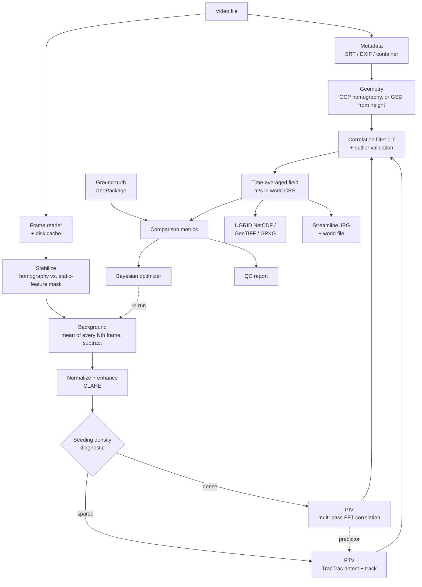

# pXv Development Plan

Mixed PIV / PTV surface velocimetry for drone and lab top-view video, with a PySide6 GUI,
ground-truth-driven parameter calibration, and QGIS-ready mesh and streamline exports.

Status: revision 4. **v0.1 implemented**, see section 11.

Revision 2 folded in the reference workflow from `README.md` (Broß et al. 2026) and an inventory of
the `tractracSources/` baseline. Revision 3 folded in the ground-truth measurement protocol.
Revision 4 records what building v0.1 actually taught, in section 11.

---

## 1. Scope

Build `pXv`, a Python package plus GUI that turns a nadir-looking video of a water surface into a
georeferenced surface-velocity field.

The tool must:

1. Load a video (drone or lab rig) and read whatever metadata it carries.
2. Stabilize the frames against wind-gust drift of the aircraft.
3. Convert image pixels to real-world metres, using either ground control points (projective
   rectification) or a known flight height (nadir scaling).
4. Compute surface velocity with PIV (particle swarms), PTV (discrete drifting objects), or a
   combined PIV-guided PTV mode.
5. Compare the result against ground-truth point measurements supplied as a GeoPackage, and
   auto-tune the control parameters so that modelled and measured velocities agree.
6. Export a mesh carrying velocity magnitude and direction for QGIS, plus colour-blind-safe
   streamline images over a 50 % opacity backdrop of the flight footage.

Two data regimes must both work:

| Regime | Height | Georeferencing | Stabilization | Ground truth |
|---|---|---|---|---|
| Drone field survey | 20 to 120 m | RTK GCPs, or GNSS plus flight height | required | GeoPackage points |
| Lab top view (`ssc-samples`) | ~0.8 m | fixed scale, local CRS | usually off | none |

The lab sample is the development fixture: it exercises the whole pipeline except georeferencing
and calibration, and it is available now.

**Positioning.** TracTrac is PTV only. The reference paper below is LSPIV only. The value pXv adds
is putting both engines behind one shared geometry, stabilization, validation and calibration
frame, so the same video can be processed either way and the two results compared directly.

---

## 2. Reference workflow

`README.md` names the target workflow. The source is:

> Broß, F., Dorthe, C., Schalko, I., 2026. Hydrodynamic and ecological effects of engineered
> logjams: Insights from field observations. *Earth Surface Processes and Landforms* 51, e70322.
> https://doi.org/10.1002/esp.70322

Emme River, Switzerland, 730 m restored reach, engineered logjams, drone imaging plus LSPIV plus
electrofishing. Their processing chain, which is the five lines noted in the README, is:

| # | README line | What the paper actually does |
|---|---|---|
| 1 | ioli drone stabilization | Each frame rectified against non-moving key features (GCPs, rocks, logs), following Ioli et al. (2020) |
| 2 | background subtraction | Background subtracted from every frame |
| 3 | every 10. image averaging, then normalize | The background *is* the mean of every tenth frame of the whole video; result is then normalized |
| 4 | image enhancement | Contrast enhancement to improve particle visibility |
| 5 | correlations filter | PIV vectors rejected below a correlation threshold of 0.7 |

Lines 2 and 3 describe one step, not two: build a static background as the mean of every tenth
frame across the full video, subtract it from each frame, normalize.

**Their concrete settings, adopted as pXv defaults:**

| Quantity | Value | Note |
|---|---|---|
| Interrogation window | 64 px | |
| Window overlap | 50 % | |
| Correlation threshold | 0.7 | the "correlations filter" |
| Background | mean of every 10th frame, whole video | static, not adaptive |
| Seeding | biodegradable corn, 3.5 x 3 x 2 cm, hand-thrown upstream | discrete objects, so PTV is also viable on this data |
| GCPs | 20, Emlid Reach RS2+ RTK | |
| Georeferencing precision | 1.3 cm (1 sigma) | |
| Orthophoto | Agisoft Metashape Professional | |
| Inflow normalization | streamwise velocity averaged over the first 400 px and full river width | makes runs comparable across discharges |

Stabilization reference:

> Ioli, F., Pinto, L., Passoni, D., Nova, V., Detert, M., 2020. Evaluation of airborne image
> velocimetry approaches using low-cost UAVs in riverine environments. *ISPRS Archives*
> XLIII-B2-2020, 597-604. https://doi.org/10.5194/isprs-archives-XLIII-B2-2020-597-2020

PTV reference:

> Heyman, J., 2019. TracTrac: A fast multi-object tracking algorithm for motion estimation.
> *Computers & Geosciences* 128, 11-18. https://doi.org/10.1016/j.cageo.2019.03.007

**One deliberate deviation.** The paper rectifies each frame relative to the *preceding* frame.
Frame-to-frame chaining accumulates drift over a long clip. pXv will track frame to frame for speed
but re-anchor periodically against a global reference frame, and will report the residual so the
difference is measurable rather than assumed. See section 4.3.

**Note on seeding.** Hand-thrown 3.5 cm corn particles at 20 to 120 m altitude are large, discrete,
sparse objects. That is closer to PTV's natural regime than PIV's. Running both engines on the same
clip and comparing is exactly the experiment pXv should make easy.

---

## 3. What `tractracSources/` gives us

TracTrac v3.0 Python, 1248 lines, `tractrac.py`. Upstream is MIT licensed, same as pXv, so porting
is clean and needs attribution only. The vendored copy is missing its `LICENSE` file, which should
be restored for attribution compliance.

**Inherited, reuse directly:**

| Component | Function | Note |
|---|---|---|
| Object detection | `blob_detection`, `feature_detection`, `maximaThresh` | difference-of-Gaussian and Laplacian-of-Gaussian kernels, automatic thresholding |
| Sub-pixel refinement | `subpix2nd` | quadratic or Gaussian, claimed 0.01 px |
| Motion model | `Propagate_MotionModel_KdTree` | KdTree nearest-neighbour prediction plus outlier rejection at `filter_std` sigma |
| Projective transform | `imProj` | reads a 4-row `projection.txt`, `cv2.getPerspectiveTransform` |
| Adaptive background | `BG`, `BGspeed` in `imProc` | running background, *different* from the reference workflow's static one |
| Live parameter reload | `*_par.txt` re-read during processing | genuinely useful, keep the idea in the GUI |
| Outputs | 32-bit TIFF average maps, ASCII, HDF5 trajectories | filename encodes value range |

**Missing, pXv must add:**

- **No stabilization at all.** This is the single largest gap and the reason the README names Ioli.
- **No PIV.** TracTrac is pure PTV.
- **Projection is 4 points only,** via `getPerspectiveTransform`. With 20 RTK GCPs you want
  `cv2.findHomography` with RANSAC over all of them, plus a per-point residual report. Straight
  upgrade of `imProj`.
- **No static background** of the every-10th-frame kind the reference workflow specifies.
- **No CRS, no georeferencing, no ground-truth comparison, no calibration, no mesh export.**
- **No lens distortion correction.**

**The key structural insight:** `Propagate_MotionModel_KdTree` is already a displacement predictor
built from previously tracked neighbours. The combined mode in section 4.5 is just seeding that
predictor from a PIV field instead of, or in addition to, the KdTree. The integration point is
narrow and well defined.

**The lab fixture, `ssc-samples/MQ-slots.mp4`,** measured from the container:

- 1080 x 1920, portrait orientation, H.264, plus an audio track, so this is phone-shot, not drone
- 1400 frames, 46.68 s, 29.99 fps
- `MQ-slots_par.txt`: full-frame ROI, automatic peak threshold, `peak_conv_size 2.0`,
  `motion_av 10`, `filter_std 1.5`, `vid_loop 2`, adaptive background off
- TracTrac output already present in `ssc-samples/TracTrac/`, with ranges encoded in the filenames:
  `Umag` 0 to 39.05, `Ux` -31.14 to 28.08, `Uy` -34.67 to 38.50, all px/frame, and `N` 1 to 76
  samples per cell

Those existing outputs are the regression baseline for M4: a pXv PTV run on this clip with the same
parameters must reproduce them.

Other sample data worth keeping: `Sample_videos/RiverDrone/*.tif` (four frames, 3900 x 1500 ROI, a
real drone river sequence) and `Sample_videos/PIVChallenge/*.tif` (a synthetic PIV benchmark, ideal
for validating the PIV core in M3).

---

## 4. Pipeline and design decisions



Stabilization comes first, before background and enhancement, matching the reference workflow.

### 4.1 Drone metadata: what a Mavic 3 actually records

Yes, the Mavic 3 records the data you need, but not inside the MP4 where most tools look.

- With **Video Captions enabled** in DJI Fly, every recording writes a sidecar `.SRT` next to the
  `.MP4` on the SD card. Each subtitle entry carries a timestamp plus a bracketed field list:
  `latitude`, `longitude`, `rel_alt`, `abs_alt`, `iso`, `shutter`, `fnum`, `ev`, `focal_len`, and on
  newer firmware `gb_yaw`, `gb_pitch`, `gb_roll` (gimbal attitude). Sample rate is typically 1 Hz or
  per-frame depending on firmware.
- The MP4 also carries a proprietary DJI binary telemetry track under `moov/udta`. `exiftool -ee`
  extracts part of it. Treat this as a fallback only.
- If captions were off, the SRT does not exist and cannot be recovered. The GUI then falls back to
  manual entry of flight height and heading.

The metadata reader is therefore a tolerant, multi-source resolver, reporting per-field provenance
so you can see which numbers are measured and which are assumed.

**Critical caveat on height.** `rel_alt` is height above the *takeoff point*, not above the water
surface, and `abs_alt` is barometric and routinely wrong by several metres. Ground sampling distance
scales linearly with height, so a 2 m height error at 40 m altitude is a 5 % velocity bias applied
uniformly to the whole field. The GUI asks explicitly for a takeoff-to-water-surface offset,
defaults it to zero with a visible warning, and treats the resulting height as calibratable once
ground truth exists.

With RTK GCPs in the frame this whole problem disappears, which is why section 4.2 Case A is the
preferred path and matches what the reference study did.

### 4.2 Pixel-to-metre geometry: three cases

**Confirmed: no dedicated RTK ground control points will be in frame, only the measurement
locations themselves.** Case C is therefore the primary path, not Case A.

- **Case A, dedicated GCPs.** Solve a homography image to world with `cv2.findHomography` and RANSAC
  over all GCPs, not `getPerspectiveTransform` over exactly four, and report per-GCP residuals. Not
  available for this survey as planned, but see the field-protocol note below.
- **Case B, height only.** Assume nadir view and flat water. Then
  `GSD = 2 * H * tan(HFOV / 2) / image_width`, uniform across the frame. Position from the SRT nadir
  lat/lon, orientation from gimbal yaw. Accuracy limited by the takeoff-to-water offset of section 4.1.
- **Case C, hybrid. The primary path here.** Case B as initial guess, refined by least squares against
  the surveyed measurement locations wherever those are identifiable in the imagery (a wading rod, a
  staff, a boat, a person). The measurement points then do double duty as geometric control and as
  velocity validation. That is not circular, since the geometry fit uses their *positions* and the
  validation uses their *velocities*, but it does mean the scale is no longer independently pinned. See
  the Tier 0 note in section 4.6.

**Conditioning warning.** Measurement verticals are usually laid out along a few cross-sections. Points
that are collinear, or clustered in one part of the frame, give a badly conditioned or outright
degenerate homography. pXv will compute and display the condition number and the spatial spread of the
control set, and refuse to fit a full projective transform when the geometry does not support one,
falling back to a similarity transform (scale, rotation, translation) which needs far less spread.

**Field-protocol recommendation, worth doing before the next flight.** Lay out four to eight cheap
high-contrast targets on the banks, well spread across the frame, and shoot them with the GNSS you
already use for the measurement points. Painted boards or plastic sheets are enough. This costs almost
nothing, moves the survey to Case A, and removes both the flight-height uncertainty and the
conditioning problem in one step. It is the single highest-value change to the field procedure.

Note that Mavic 3 video modes crop the sensor differently from stills, so the nominal 24 mm
equivalent focal length does not directly give the video FOV. Ship a per-mode FOV table plus a
one-off checkerboard calibration utility, with optional lens distortion correction.

An orthophoto route via Metashape, as in the paper, stays available: pXv accepts a georeferenced
orthophoto and solves the video-to-ortho homography against it.

### 4.3 Stabilization

Water is a non-rigid, constantly moving surface, so a global homography must be estimated from
**static** pixels only.

- The user draws a stable-region polygon over banks, structures, rocks, logs or exposed bars.
  Everything outside it, meaning the water, is ignored for stabilization. Masking the flow area is
  exactly what Ioli et al. (2020) do.
- Shi-Tomasi corners inside the mask, pyramidal Lucas-Kanade tracking, RANSAC homography, or a
  similarity transform when only translation, rotation and scale are expected.
- **Key-frame anchoring.** Track frame to frame for speed, but periodically re-match against a global
  reference so error does not accumulate. This is the deliberate deviation from the paper's
  frame-to-preceding-frame chaining, noted in section 2.
- Warp every frame into the reference frame *before* background subtraction and velocimetry.
- Report per-frame residual RMS reprojection error and surviving inlier count as a QC time series.
  This is the single best indicator of whether stabilization succeeded, and most tools hide it.
- If GCPs are visible throughout, stabilization and rectification collapse into one homography per
  frame straight to world coordinates. Offer that as a mode.
- For the lab sample, where water fills the frame and no static features exist, stabilization is
  disabled, or driven by fiducial markers on the flume walls.

### 4.4 Preprocessing

Implement the reference recipe exactly, and keep TracTrac's alternative alongside it:

1. Grayscale.
2. **Static background**: mean of every Nth frame across the whole video, N = 10 by default,
   subtracted from each frame. This is the reference workflow's method. It needs one full pass over
   the video before processing, so it pairs naturally with the frame cache.
3. **Normalize** intensity.
4. **Enhance**: CLAHE by default, with clip limit and tile size exposed.
5. Optional: TracTrac's adaptive running background (`BG`, `BGspeed`) instead of step 2, and median
   denoising (`noise`, `noise_size`).

A static background removes stationary sun glint and fixed bright spots cleanly, which is its main
advantage over the adaptive variant on drone footage.

### 4.5 PIV, PTV, and the combined mode

**Choosing automatically.** Compute the density of detectable features per candidate interrogation
window: above roughly 8 particles per window PIV is well posed; 1 to 8 favours PTV or ensemble
PIV; below 1 is PTV only. Surface this as a recommendation with a histogram, not a silent switch.

**Confirmed: both seeded reaches and unseeded reaches relying on natural surface texture.** That makes
the diagnostic load-bearing rather than a convenience, since the right engine genuinely differs between
clips from the same survey. Seeded reaches will tend toward PTV (sparse discrete objects), unseeded ones
toward PIV (dense continuous texture), and the diagnostic decides per clip rather than per survey. The
project file records which engine was chosen and why, so a mixed-mode survey stays auditable.

**Combined mode is not "run both and average". It is PIV-guided PTV:**

1. Multi-pass PIV produces a coarse but robust dense field.
2. That field seeds TracTrac's motion model, so PTV search windows shrink and mismatches collapse.
3. PTV returns scattered vectors at higher spatial resolution than the PIV grid.
4. Fusion bins PTV vectors onto the output grid. Where PTV sample count suffices, PTV wins,
   elsewhere the field falls back to PIV.
5. Every output cell carries a `source` flag and an `n_samples` count, so provenance stays visible.

**PIV core: own it rather than depend on it.** Implement the multi-pass FFT cross-correlation core
inside pXv and treat OpenPIV as an optional cross-check. The core is roughly 200 lines: FFT
correlation, Gaussian sub-pixel peak fit, window deformation, correlation-coefficient and
signal-to-noise validation. OpenPIV's release cadence and NumPy 2.x compatibility are uncertain, and
a research tool that silently breaks on a dependency bump is worse than one that owns its numerics.
Owning it also lets the optimizer reach parameters the library does not expose, and lets us
implement the 0.7 correlation filter exactly as the reference workflow defines it.
`Sample_videos/PIVChallenge/` is the validation fixture. Flag this decision if you disagree.

For PTV, port TracTrac rather than re-deriving it.

### 4.6 Ground-truth calibration: what to tune and what not to

This is the part most likely to produce a confident wrong answer, so parameters split into tiers and
only one tier reaches the optimizer.

**Tier 0, fixed first, never optimized blindly.** Ground sampling distance or GCP homography, frame
interval, CRS, stabilization quality. If the GSD is wrong, an optimizer will happily compensate by
shrinking the interrogation window until the numbers match, producing a meaningless field that
validates perfectly. Set from geometry and metadata, then inspect visually. Geometric residuals and
stabilization residuals are the acceptance gates.

**Tier 0.5, the one exception, and only because Case C is the geometry path.** Without dedicated GCPs
the absolute scale carries real uncertainty, driven by the takeoff-to-water-surface offset. Allow
exactly one global scale factor to be fitted against the ground truth, but fit it **alone and first**,
as a single-parameter least-squares problem with every Tier 1 parameter held at its reference value.
Then freeze it and never expose it to the Tier 1 optimizer. Fitting scale and interrogation window
simultaneously lets them trade off against each other, which is the exact failure mode Tier 0 exists to
prevent. Report the fitted scale next to the metadata-derived one: a large disagreement means the height
offset is wrong, and that is a finding, not a nuisance.

**Tier 1, the actual search space,** seeded from the reference workflow's values:

| Parameter | Reference value | Search range |
|---|---|---|
| Interrogation window | 64 px | 32 to 128 |
| Overlap | 50 % | 25 to 75 % |
| Passes | not stated | 1 to 3 |
| Correlation threshold | 0.7 | 0.4 to 0.9 |
| Background frame stride | 10 | 5 to 50 |
| CLAHE clip limit | not stated | 1 to 8 |
| Frame step | not stated | 1 to 5 |
| PTV `peak_conv_size` | n/a | 1 to 10 px |
| PTV `filter_std` | n/a | 1.0 to 3.0 |
| PTV `motion_av` | n/a | 5 to 30 |

**Tier 2, physical conversion, handled separately.** Confirmed: the ground truth is measured at
**0.6 h and 0.8 h above the riverbed**, so it is neither depth-averaged nor surface velocity. A single
constant alpha is therefore the wrong model, and the conventional 0.85 does not apply. See section 4.9
for the profile-based conversion that replaces it. Whatever that conversion produces, it stays out of
the Tier 1 search space, or a physical bias gets baked into numerical settings.

**Objective function:**

```
J = w_mag * RMSE(|v|)  +  w_dir * mean angular error
    +  penalty(low vector yield, high outlier rate)
```

The penalty term matters: without it the optimizer finds degenerate settings that return three
excellent vectors and nothing else. Raising the correlation threshold is precisely such a lever, so
the penalty is not optional here.

Both terms are live for this dataset. The GeoPackage carries **velocity components or direction**, so
the angular term is a real constraint rather than a placeholder, and it is the term most sensitive to a
bad homography. It also carries **per-point instrument uncertainty**, so each residual is weighted by
`1 / sigma_i^2` and noisy verticals stop dominating the fit. Points whose ground truth was converted
through the noisier two-point extrapolation of section 4.7 carry their propagated uncertainty into the
same weighting.

**Optimizer:** Optuna TPE, or `skopt.gp_minimize`, over 30 to 60 evaluations on a short
representative clip, seeded with a Latin hypercube around the reference values above. Full-length
runs only after convergence.

**Validation:** hold out a subset of ground-truth points, or run k-fold across them. Report
calibration and validation error separately. With a handful of ADV points it is trivially easy to
overfit, and the report must make that visible rather than hide it.

**Seed heuristic, the quarter rule.** Particle displacement should be about one quarter of the
interrogation window, so `window_px ~= 4 * v_expected * dt / GSD`. Worth checking against the
paper's 64 px choice once your flight height and frame rate are known.

**Optional inflow normalization.** The paper normalizes by the streamwise velocity averaged over the
first 400 px and the full river width. Expose this as a post-processing option, since it is how runs
at different discharges are made comparable, but keep it off by default and never inside the
optimizer loop.

### 4.7 Converting ground truth to surface velocity

The ground truth is measured at 0.6 h and 0.8 h above the bed. pXv measures velocity at the free
surface. These are different quantities and must be reconciled explicitly.

Note that this is *not* the conventional "0.6 depth" gauging convention, which means 0.6 of the depth
measured downward *from the surface*, that is 0.4 h above the bed, and which exists precisely because
it approximates the depth-averaged velocity. Measured *upward from the bed*, 0.6 h and 0.8 h sit high
in the profile, much closer to the surface. That is good news: the conversion factor is nearer to one
and carries less uncertainty than a depth-average conversion would.

**Direction of conversion.** Convert the ground truth *up* to surface velocity, never the pXv field
down. Three reasons: the comparison then happens in the space where pXv's output actually lives; the
conversion is a per-point operation, so each point carries its own propagated uncertainty and can be
weighted accordingly in the objective; and the exported velocity field stays a true surface field,
uncontaminated by profile assumptions.

**Case 1, both heights measured on the same vertical. Preferred.** Two points on a logarithmic profile
determine it completely, with no assumed roughness and no separate depth measurement:

```
u(z) = (u* / kappa) * ln(z / z0)

u_surface = u1 + K * (u2 - u1),    K = ln(1/0.6) / ln(0.8/0.6) = 1.7757
```

where `u1` is the 0.6 h value and `u2` the 0.8 h value. This is the strongest option available and it
removes the single largest source of systematic error in the whole calibration chain.

Its weakness is noise. `u2 - u1` is a small difference between two similar numbers, so for independent
measurements of equal standard deviation the extrapolation amplifies uncertainty by a factor of
**1.94**. The estimator is unbiased but noisy.

**Case 2, one height only.** Fall back to a log-law ratio, which needs the local water depth `h` and a
roughness length `z0` (from `z0 ~ k_s / 30`, `k_s ~ 2.5 D84`):

```
u(z) / u_surface = 1 + ln(z / h) / ln(h / z0)
```

| h / z0 | ln R | u_bar / u_s | u(0.6h) / u_s | u(0.8h) / u_s |
|---|---|---|---|---|
| 30 | 3.40 | 0.706 | 0.850 | 0.934 |
| 60 | 4.09 | 0.756 | 0.875 | 0.945 |
| 100 | 4.61 | 0.783 | 0.889 | 0.952 |
| 300 | 5.70 | 0.825 | 0.910 | 0.961 |
| 1000 | 6.91 | 0.855 | 0.926 | 0.968 |
| 3000 | 8.01 | 0.875 | 0.936 | 0.972 |

So the correction is typically 6 to 15 % at 0.6 h and only 3 to 7 % at 0.8 h, against roughly 15 to 30 %
for a depth-averaged measurement. The `u_bar / u_s` column is the conventional alpha, shown to make the
contrast explicit.

**Recommended hybrid. Confirmed as the operative case: coverage varies by point, some verticals have
both heights and some have one.** Where both heights exist, use Case 1 per vertical to *estimate* the
site's effective `z0`, take a robust central value (median, or a distance-weighted local estimate)
across those verticals, and apply the resulting smoothed ratio to every point via Case 2. This keeps
Case 1's freedom from roughness assumptions while avoiding its noise amplification. Report both the
per-point and the smoothed results so the difference stays visible.

This hybrid matters more than it first appears, because **the GeoPackage carries no bed grain size**.
The two-point verticals are therefore the only physical source of roughness information at the site,
and without them `z0` would be a literature guess.

The good news is that the guess is cheap. Over the entire plausible range of relative submergence in
the table above, `h/z0` from 30 to 3000, the conversion ratio moves by only about **4 % at 0.8 h** and
about **9 % at 0.6 h**. A badly chosen roughness is a bounded, quantifiable error, not an open-ended
one, and pXv will report that sensitivity band alongside the converted value rather than presenting a
single number as if it were exact.

**Caveats to state in the QC report, not bury:**

- The log law is weakest in the upper part of the flow, where a wake correction (Coles) applies.
  Extrapolating from 0.6 to 0.8 h to the surface therefore tends to *underestimate* surface velocity
  slightly.
- Floating tracers move with the surface current *plus* wind drag on their freeboard. Corn particles
  3.5 cm on a side have meaningful freeboard. Wind speed and direction at the time of flight are worth
  recording.
- Secondary currents and the logjam wakes that are the subject of the reference study both distort the
  profile locally. Points inside a wake should be flagged and optionally excluded from calibration.
- Near-bank and shallow verticals violate the log law first. Filter on relative submergence.

**Ground-truth attributes, confirmed available:** water depth `h`, velocity components or flow
direction, and per-point instrument uncertainty. Not available: bed grain size. pXv's reader validates
these on load and refuses to calibrate against points that lack what the chosen conversion needs.

### 4.8 Outputs

**Mesh for QGIS.** Primary format is UGRID-conventions NetCDF, which QGIS reads natively as a Mesh
Layer through MDAL and renders with built-in arrow, streamline and particle-trace styling. Datasets:
velocity vector (u, v) plus derived magnitude and direction, with time steps if you want the temporal
evolution rather than only the average.

Secondary: **SELAFIN** `.slf`, also MDAL-readable, which drops straight into your TELEMAC workflow
for comparison against simulated fields; **GeoTIFF** with three bands (u, v, magnitude); and
**GeoPackage points**, one feature per grid node with `u`, `v`, `magnitude`, `direction`,
`n_samples`, `source`. Keep TracTrac's 32-bit TIFF average maps and HDF5 trajectory output too, so
existing post-processing still works.

**Streamline images.** Matplotlib `streamplot`, line colour mapped to velocity magnitude using
**cividis** (designed for colour-vision deficiency) or **viridis**, with `batlow` from cmcrameri as
an option. Perceptually uniform sequential maps only, never a rainbow map. Underneath sits the
orthorectified median frame of the flight at alpha 0.5. Every export carries a colourbar with units,
a scale bar and a north arrow, and is written with a `.jgw` world file and `.prj` so the JPG itself
drags into QGIS already georeferenced.

**QC report.** One HTML page per run: metadata found and its provenance, GSD or GCP residuals,
stabilization residual time series, vector yield and outlier percentage, ground-truth scatter with
RMSE, bias, R-squared and angular error, and the exact parameter set used.

### 4.9 Reproducibility

Every run is fully described by a single YAML project file. The GUI only edits that file, and
`pxv run project.yaml` reproduces the run headlessly. Nothing the GUI can do is unreachable from the
command line, which keeps the tool usable in batch and testable in CI. TracTrac's live-reloaded
`*_par.txt` is a good idea worth keeping as a GUI behaviour, but the YAML project file is the
system of record.

---

## 5. Package layout

```
pxv/
  project.py              project schema, YAML load/save, validation
  cli.py                  pxv run | pxv calibrate | pxv export
  io/
    video.py              PyAV / OpenCV reader, frame-accurate seek, memmap cache
    metadata.py           SRT parser, exiftool fallback, provenance tracking
    groundtruth.py        GeoPackage reader via geopandas, CRS handling
    tractrac_par.py       read and write TracTrac *_par.txt, for interoperability
  preprocess/
    background.py         static every-Nth-frame background, adaptive fallback
    enhance.py            grayscale, normalize, CLAHE, high-pass, median denoise
    mask.py               polygon masks for water and stable regions
  stabilize/
    homography.py         feature tracking, RANSAC, key-frame anchoring, warping
    quality.py            residual and inlier-count metrics
  geometry/
    intrinsics.py         camera models, per-mode FOV table, checkerboard calibration
    gsd.py                nadir scaling from height
    world.py              GCP homography via findHomography+RANSAC, CRS transforms
    rectify.py            orthorectification, orthophoto matching
  velocimetry/
    piv.py                multi-pass FFT correlation, window deformation, sub-pixel fit
    ptv.py                TracTrac port: detection, subpix, KdTree motion model
    fuse.py               PIV-guided PTV, binning, provenance flags
    validate.py           correlation threshold, median, global outlier filters
    density.py            seeding diagnostic
  calibrate/
    profile.py            log-law conversion of ground truth to surface velocity
    objective.py          metrics, holdout splitting
    optimize.py           Optuna / skopt driver
    report.py             HTML QC report
  export/
    mesh_ugrid.py         UGRID NetCDF
    selafin.py            SELAFIN writer, optional
    raster.py             GeoTIFF, plus TracTrac-compatible 32-bit TIFF maps
    vector.py             GeoPackage points
    streamlines.py        streamplot + backdrop + world file
  gui/
    app.py, main_window.py
    pages/                one widget per wizard step
    widgets/              video scrubber, GCP picker, mask editor, vector overlay
    workers.py            QThread wrappers, progress, cancellation
tests/  docs/  examples/
tractracSources/          vendored upstream, read-only reference
```

**GUI shape.** A `QStackedWidget` wizard with steps Project, Video, Stabilize, Mask, Geometry,
Velocimetry, Calibrate, Export. Left panel holds parameters, centre holds a `pyqtgraph` image view
with a frame scrubber and toggleable overlay layers (mask, GCPs, vectors, ground-truth points),
bottom holds the log and QC plots. Every long operation runs in a worker thread with a progress bar
and a working cancel button. Nothing blocks the UI thread.

---

## 6. Milestones

Each milestone ends in something runnable. Everything through M4 is validatable on data already in
the repository.

| # | Deliverable | Validated by | Status |
|---|---|---|---|
| M0 | Repo scaffolding, project schema, CLI skeleton, environment file, housekeeping from section 9 | `pxv --help` | done |
| M1 | Video reader, frame cache, SRT metadata parser, TracTrac `_par.txt` reader, GUI shell | plays `MQ-slots.mp4`, parses a real Mavic SRT | done |
| M2 | Preprocessing (static background, normalize, CLAHE), mask editor, stabilization, residual QC | synthetic shifted frames recover a known shift | done |
| M3 | PIV core, correlation filter, outlier validation, vector overlay in GUI | `Sample_videos/PIVChallenge/` recovers the known benchmark field | done |
| M4 | PTV port, seeding diagnostic, combined PIV-guided mode | reproduces `ssc-samples/TracTrac/` maps to within tolerance | done |
| M5 | Geometry: GCP homography with residuals, nadir GSD, orthorectification, CRS | `Sample_videos/projection.txt` round-trips; lab sample gives correct m/s | done |
| M6 | Ground-truth ingestion, comparison metrics, HTML QC report | your drone video plus GeoPackage | reader and conversion done, needs your data |
| M7 | Bayesian auto-calibration with holdout validation | calibration vs. validation error reported separately | implemented, unexercised |
| M8 | Exports: UGRID mesh, GeoTIFF, GeoPackage, streamline JPG plus world file | layers load and render in QGIS | done |
| M9 | Packaging, docs, test suite, worked example | fresh-environment install | tests and docs done |

M0 to M5 are the bulk of the work and are unblocked today. M6 and M7 need your drone video and
ground-truth file.

---

## 7. Dependencies

Already present in `hydromate-env`: numpy 2.5, scipy, pandas, matplotlib, PySide6 6.11, geopandas,
rasterio, pyproj, shapely, fiona.

To add:

| Package | Purpose | Note |
|---|---|---|
| `opencv-python-headless` | features, tracking, warping, CLAHE, homography | **headless variant is mandatory**, the normal wheel bundles its own Qt and will clash with PySide6 |
| `av` (PyAV) | frame-accurate decoding with real timestamps | more reliable than OpenCV's frame counter |
| `scikit-image` | filters, registration helpers | |
| `h5py` | TracTrac HDF5 trajectory output | already a TracTrac requirement |
| `numba` | PTV inner loops | optional, large speedup |
| `pyqtgraph` | fast interactive image and vector display | |
| `xarray`, `netCDF4` | UGRID mesh writing | |
| `optuna` | parameter optimization | or `scikit-optimize` |
| `cmcrameri` | scientific colour maps | optional |
| `exiftool` (binary) | embedded telemetry fallback | system package, currently missing |
| `ffmpeg` (binary) | container inspection, transcode fallback | currently missing |

Dropped from TracTrac's requirements: `imutils` (thin OpenCV wrapper, not worth a dependency),
`parse` (only used for the `_par.txt` reader, replaceable with stdlib).

`openpiv` stays optional, used only to cross-validate our own PIV core.

---

## 8. Risks

| Risk | Impact | Mitigation |
|---|---|---|
| Video captions were off, so no SRT exists | no height, position or heading | GCP path (Case A) does not need them at all; manual entry otherwise |
| Height above *water* differs from `rel_alt` above takeoff | uniform velocity bias | explicit offset field; prefer GCPs; refine against ground truth |
| Frame-to-preceding-frame stabilization drifts over a long clip | slow systematic error the paper's method would not reveal | key-frame anchoring plus a published residual time series |
| Stabilization fails when banks are out of frame or featureless | spurious apparent velocity | residual QC surfaced prominently; allow manual fiducials |
| Sun glint and specular reflections | correlation locks onto static glare | static every-Nth-frame background removes stationary glint; glint masking |
| Sparse hand-thrown seeding breaks PIV correlation | low vector yield, biased field | seeding diagnostic; PTV and ensemble PIV as alternatives |
| Measurement points collinear along cross-sections | degenerate or ill-conditioned homography | condition number and spatial spread reported; automatic fallback to a similarity transform |
| Very few ground-truth points | calibration overfits | holdout or k-fold, report both errors, restrict search to Tier 1 |
| Ground truth is depth-averaged, not surface | systematic offset absorbed into the wrong parameters | explicit alpha in Tier 2 |
| MDAL / QGIS version differences in UGRID support | mesh will not load | GeoTIFF and GeoPackage fallbacks always written |
| Long 4K clips are slow | unusable interactivity | ROI cropping, frame decimation, memmapped cache, short clip for calibration |
| `tractracSources/matplotlibrc` forces the TkAgg backend | fights the PySide6 GUI event loop | never import TracTrac's module-level plotting; port the algorithm, not the visualization |

---

## 9. Repository housekeeping

Small, worth doing at M0:

1. **`tractracSources/tractrac-env/` is a broken, half-committed virtualenv.** It is Python 3.10
   with `home = /usr/bin`, and only `bin/` plus a dangling `lib64` symlink made it into the commit,
   because the root `.gitignore` rule `lib/` excluded the actual packages. It cannot work on this
   machine and it is not useful as a reference. Remove it with `git rm -r --cached` and add
   `tractrac-env/` to `.gitignore`.
2. **Editor backup files committed**: `Sample_videos/videotest.txt~` and
   `Sample_videos/videotest_par.txt~`. Add `*~` to `.gitignore` and remove them.
3. **Add TracTrac's upstream `LICENSE`** to `tractracSources/`. Upstream is MIT, same as pXv, so
   there is no compatibility problem, but attribution should be preserved.
4. **Large binaries are now in git history**: `MQ-slots.mp4` is 58 MB, and the RiverDrone and
   PIVChallenge TIFFs add roughly 42 MB. If the repository is going to accumulate more sample
   videos, move them to Git LFS or an external data directory before the history gets worse.
5. **Consider pinning `tractracSources/` as a read-only vendored reference** and never importing
   from it at runtime, so the TkAgg `matplotlibrc` and the Python 2 era idioms cannot leak into pXv.

---

## 10. Open questions

Resolved:

- Paper reference and workflow: section 2.
- `tractracSources` baseline: section 3.
- **Ground-truth reference level: 0.6 h and 0.8 h above the bed**, coverage varying by point. Neither
  depth-averaged nor surface. Handled by the hybrid profile conversion in section 4.7, which replaces
  the single alpha coefficient.
- **GeoPackage attributes**: water depth, velocity components or direction, per-point instrument
  uncertainty. No bed grain size, so roughness comes from the two-point verticals.
- **No dedicated RTK GCPs in frame**, only the measurement locations. Case C hybrid geometry, with the
  Tier 0.5 scale fit of section 4.6 and the conditioning safeguards of section 4.2.
- **Seeding varies by reach**, both seeded and natural texture, so the seeding-density diagnostic
  chooses the engine per clip.

Still open:

1. **Which instrument**, and its stated uncertainty magnitude? ADV, propeller current meter, ADCP. The
   value matters less than the scale: whether typical sigma is 1 %, 5 % or 15 % of the reading decides
   how much the two-point extrapolation of section 4.7 can be trusted, since it amplifies sigma by 1.94.
2. **Target CRS** for outputs. UTM 32N (EPSG:25832) for a German site, CH1903+ / LV95 (EPSG:2056) for a
   Swiss one.
3. **Are the measurement locations actually identifiable in the footage?** A wading rod, staff, boat or
   person at the vertical is enough. If nothing marks them, Case C loses its control points and the
   geometry falls back to pure Case B on flight height alone.
4. **Video specification**: resolution, frame rate, clip duration, and whether the gimbal is locked to
   nadir.
5. **Wind conditions** at the time of flight. Relevant to stabilization load and to tracer drift on the
   seeded reaches, see section 4.7.
6. **`MQ-slots`**: what is the experiment, and is there a known reference velocity or discharge? Even a
   single flume discharge would turn the lab clip from a smoke test into a validation case for M5.

---

## 11. Implementation notes, v0.1

Roughly 4100 lines under `pxv/`, 640 lines of tests, 66 tests passing. The
package is installable, the CLI and the PySide6 GUI both drive the same project
YAML, and the whole chain runs end to end on the lab clip in this repository.

### 11.1 Three bugs the design did not anticipate

**A textureless window correlates perfectly with itself.** After background
subtraction and CLAHE, flat regions have near-zero variance, and the
normalisation `n * std_a * std_b` then divides by almost nothing. Static
background scored a correlation of 1.0 at zero displacement and outranked the
moving water, which is the exact opposite of what the correlation filter is for.
Fixed with a `min_texture` guard that invalidates windows below a variance floor.
Regression test: `test_flat_window_is_not_reported_as_valid`.

**Peak-to-second-peak SNR collapses on broad peaks.** With a 5 x 5 exclusion
around the primary peak, the "second peak" is just the shoulder of the first, so
the ratio sits at about 1.05 for every window and a threshold of 1.3 rejected
essentially every real vector. Real correlation peaks on water are several pixels
wide. Fixed by making the exclusion radius configurable and defaulting to a
peak-to-RMS measure, which stays meaningful when the peak is wide. On the lab
clip this moved the median SNR from 1.06 to 3.62 and turned a useless field into
a usable one.

**Connecting a plain function to a Qt signal gives a direct connection.** Qt has
no receiver context for a bare callable, so the callback executes in the *worker*
thread. Every result handler that touched a widget was a race. Fixed with a
`Dispatcher` QObject that lives in the GUI thread; the connection then resolves to
queued as intended.

### 11.2 What the lab clip actually is

`ssc-samples/MQ-slots.mp4` is a vertical-slot fishway pool at MQ, 60 L/s in a
0.5 m flume, filmed on a phone: 1080 x 1920 portrait, letterboxed, 30 fps, with an
audio track. Two findings matter beyond this clip:

**It is a view *through* clear water onto a static bed.** The dominant image
texture is the stationary gravel, not surface tracers. Correlation locks onto the
bed, and no amount of parameter tuning changes that, because the bed really is
the strongest signal in the frame. What survives is the surface ripple modulating
that texture, which is weaker and decorrelates faster. Consequence for the design:
the seeding-density diagnostic is necessary but not sufficient. It counts
detectable objects and cannot tell a moving tracer from a static stone. A
"static-fraction" diagnostic, the share of cells whose displacement is
indistinguishable from zero over the whole clip, would catch this and is worth
adding.

**The reference workflow's 0.7 correlation threshold does not transfer.** It was
tuned for seeded LSPIV with corn particles, where correlation is genuinely high.
On unseeded water it rejects almost everything; 0.5 is workable here. This is a
concrete illustration of why the threshold belongs in Tier 1 rather than being
treated as a constant of nature.

The run does produce a physically coherent result: a single large recirculation
cell filling the pool, entering from the upper-left slot and leaving by the right
slot, which is what a vertical-slot fishway pool should look like. Static
structures, the flume rail and side rails, correctly report near-zero motion.

### 11.3 The discharge check has a precondition

Mass conservation is the cheapest independent validation available, and in a
metered flume it is the only ground truth there is. But it needs a section that
actually carries the full discharge. A horizontal line across a fishway *pool*
does not: flow enters and leaves through slots, not uniformly across the section.
The check duly returns an absurd implied depth of 12 m for this clip, which is the
check working, not failing. It is reported rather than suppressed. For a river
reach with a full cross-section in frame, the same check is meaningful.

### 11.4 Scale on the lab clip is an assumption, not a measurement

`examples/mq-slots.yaml` assumes the cropped frame spans the 0.5 m flume width,
giving 0.49 mm/px. Every velocity scales linearly with that number, and it has not
been verified. The GUI's two-point picker exists precisely for this: click the two
wall lines, type the real distance. Until that is done, treat the absolute
velocities from this clip as provisional and the field *pattern* as the result.

### 11.5 Deliberate deviations from the plan as written

- **PIV core owned, not delegated.** As recommended in section 4.5, and it paid
  off immediately: both the texture guard and the peak-to-RMS SNR are changes no
  library would have exposed.
- **Peak finding is fully vectorised over the window grid.** A per-window Python
  loop cost 3 s per frame pair, which makes a 1400-frame clip unusable. The
  vectorised version does the same work in a fraction of that and produces
  identical numbers.
- **GUI forms are generated from the dataclass schema.** The GUI therefore cannot
  drift out of sync with what a project file accepts, and a new parameter appears
  in both places at once.

### 11.6 Known gaps

- **No analysis mask.** Only a rectangular ROI. Streamlines currently run over
  static structures inside the ROI, visible along the top rail of the lab export.
  A polygon mask for the velocimetry region is the next thing to add.
- **Orthophoto registration is a stub.** `geometry.mode: orthophoto` accepts
  control points but does not yet feature-match a video frame against a
  georeferenced orthophoto. Given no RTK targets will be in frame, this is the
  highest-value remaining item, see section 10.
- **The Tier 1 search is a seeded Latin hypercube over a discrete space,** not
  Optuna TPE. Adequate for 40 trials, and it avoids a hard dependency, but TPE
  should replace it once there is real ground truth to optimize against.
- **Ensemble PIV is implemented but not wired into the pipeline** as a selectable
  mode.
- **No HTML QC report yet.** The run writes a JSON report plus a quicklook PNG.
